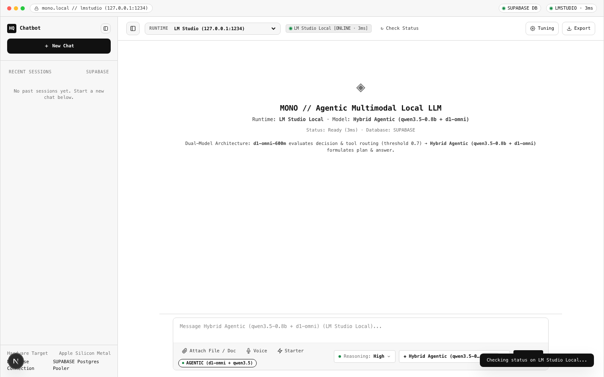

# Local LLM Multimodal & Agentic Dashboard

A modern, local-first AI dashboard and agentic workspace built with Next.js (App Router), React, and TypeScript. MONO connects to multiple local AI runtimes (LM Studio, Ollama, Hermes Agent, llama.cpp, vLLM) with multi-model routing, multimodal vision, live tool execution (web search, calculator, document Q&A), deep reasoning traces, voice interaction, and persistent session storage via Supabase with local fallback.

---

## Key Features

### 1. Multi-Runtime Architecture
- **LM Studio**: OpenAI-compatible server at `http://127.0.0.1:1234`. Supports dual-engine hybrid agentic routing.
- **Ollama**: Native Ollama API at `http://127.0.0.1:11434` with vision and thinking model support.
- **Hermes Agent**: Autonomous CLI/gateway agent with reasoning tiers and multi-step execution.
- **llama.cpp / vLLM**: Compatible with local `llama-server` (Metal/MPS) and vLLM distributed inference.
- **Runtime Health Monitoring**: Real-time status badge and ping latency for each runtime.

### 2. Agentic Routing & Tool Execution
- **Decision Model Gate (`d1-omni-600m`)**: Classifies user intent and routes tasks automatically:
  - **Live Web Search**: Real-time weather (`wttr.in`), live search engine integration, and Wikipedia fallback.
  - **Exact Arithmetic Calculator**: High-precision math and BigInt calculation without LLM hallucinations.
  - **Document Analysis & Contextual Q&A**: Direct routing when documents are attached.
  - **Direct Parametric Knowledge**: Fast zero-tool execution for conceptual inquiries.
- **Agent Execution Trace**: Interactive step-by-step accordion showing Decision Gate confidence, rationale, tool outputs, citations, and execution latency.

### 3. Multimodal & Document Q&A
- **Document Text Extraction**: Parses `.pdf` (via `pdfjs-dist` with page indexing), `.md`, `.txt`, `.csv`, `.json`, and source code files.
- **Grounded Q&A**: Injects structured document context with citation constraints for executive summaries and deep queries.
- **Vision Support**: Attach images for inspection with compatible vision models.

### 4. Reasoning & Thinking Controls
- **Configurable Reasoning Levels**: `Off`, `Low`, `Medium`, `High`.
- Collapsible `<think>` reasoning block to inspect model deliberations and step-by-step reasoning.

### 5. Hands-Free Voice Conversation
- **Speech Recognition (STT)**: Real-time speech-to-text directly in the browser.
- **Speech Synthesis (TTS)**: Natural voice readback with hands-free conversation mode.

### 6. Session Persistence
- **Dual Storage**: Automatically syncs sessions and message history to **Supabase** when configured, with seamless local JSON fallback (`.data/chat_storage.json`).

---

## Tech Stack

- **Framework**: Next.js 16 (App Router), React 19, TypeScript
- **Styling**: Tailwind CSS, Custom Mono Dark Theme
- **Markdown & Code**: `react-markdown`, `remark-gfm`
- **PDF Engine**: `pdfjs-dist`
- **Storage**: Supabase REST API & Local Filesystem JSON Store
- **Local Runtimes**: LM Studio, Ollama, Hermes Agent, llama.cpp, vLLM

---

## Requirements

- Node.js 18+ (Node.js 20+ recommended)
- At least one local AI runtime:
  - [LM Studio](https://lmstudio.ai) (default port `1234`)
  - [Ollama](https://ollama.ai) (default port `11434`)
  - [Hermes Agent](https://hermes-agent.nousresearch.com)

---

## Quick Start

### 1. Clone & Install Dependencies

```bash
git clone <repository-url>
cd chatbot
npm install
```

### 2. Configure Environment (Optional)

Create a `.env.local` file if you want Supabase cloud session persistence:

```env
NEXT_PUBLIC_SUPABASE_URL=https://<your-project-id>.supabase.co
NEXT_PUBLIC_SUPABASE_ANON_KEY=<your-anon-key>
# or SUPABASE_SERVICE_ROLE_KEY=<your-service-key>
```

> If Supabase credentials are not provided, MONO automatically falls back to local file storage under `.data/chat_storage.json`.

### 3. Start Local Runtimes

- **LM Studio**: Open LM Studio, download your preferred models (e.g. `qwen3.5-0.8b-mlx` or `qwen3-4b` and `d1-omni-600m`), and start the local server on port `1234`.
- **Ollama**: Run `ollama serve` and pull models (e.g. `ollama run qwen2.5:0.5b`).

### 4. Run Development Server

```bash
npm run dev
```

Open [http://localhost:3000](http://localhost:3000) in your browser.

---

## Project Structure

```
├── demo.png                          # Interface preview screenshot
├── demo.mp4                          # Video demonstration
├── src/
│   ├── app/
│   │   ├── api/
│   │   │   ├── chat/route.ts         # Agentic router, tool dispatch, runtime proxy & SSE streaming
│   │   │   ├── document/extract/     # PDF & document text extraction pipeline
│   │   │   ├── runtimes/route.ts     # Health checks & dynamic model discovery across runtimes
│   │   │   ├── sessions/             # Session list, create, delete, and messages endpoints
│   │   │   └── rag/route.ts          # Semantic RAG & embedding search pipeline
│   │   ├── globals.css               # Application design system and trace styling
│   │   ├── layout.tsx                # Metadata and root layout
│   │   └── page.tsx                  # Main entry point mounting ChatApp
│   ├── components/
│   │   └── ChatApp.tsx               # Dashboard interface, execution trace, audio & composer
│   ├── lib/
│   │   └── db.ts                     # Database abstraction (Supabase + local JSON store fallback)
│   └── types/
│       └── pdfjs-dist.d.ts           # Type declarations for PDF parsing
```

---

## Demo


- Video recording: [Watch demo.mp4](demo.mp4)

---

## Verification & Build

```bash
npm run lint
npm run build
```
